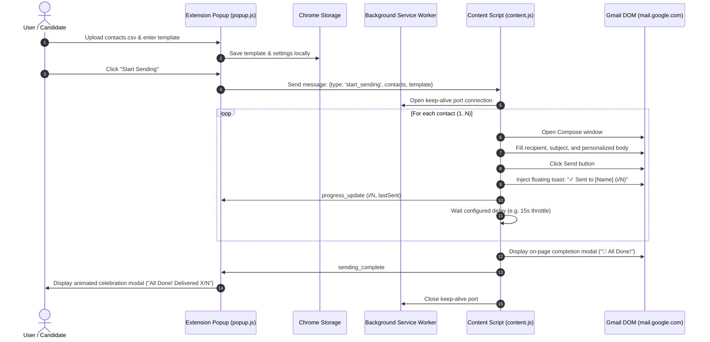

# 🚀 Placement Email Bot — Chrome Extension (Manifest V3)

[](https://developer.chrome.com/docs/extensions/mv3/intro/)
[](https://chrome.google.com/webstore)
[](LICENSE)
[](https://developer.mozilla.org/)

An automated, privacy-first **Google Chrome Extension** (Manifest V3) designed for personalized, high-volume job application and cold outreach campaigns directly through Gmail's web interface.

---

## 🏛️ System Architecture

```text
┌────────────────────────────────────────────────────────────────────────────────┐
│                           CHROME EXTENSION RUNTIME                             │
│                                                                                │
│   ┌───────────────────────────┐            ┌───────────────────────────────┐   │
│   │     EXTENSION POPUP       │            │   BACKGROUND SERVICE WORKER   │   │
│   │    (popup.html / .js)     │            │       (background.js)         │   │
│   ├───────────────────────────┤            ├───────────────────────────────┤   │
│   │ • CSV Contact Parser      │◄──────────►│ • Lifecycle & Default State   │   │
│   │ • Template WYSIWYG Editor │  Runtime   │ • Tab Query & Message Relay   │   │
│   │ • Live Preview Engine     │  Messages  │ • Keep-Alive Port Manager     │   │
│   │ • Throttle Delay Slider   │            │ • Storage Synchronization     │   │
│   │ • Done Celebration Modal  │            └───────────────┬───────────────┘   │
│   └─────────────┬─────────────┘                            │                   │
│                 │                                          │                   │
│                 │ chrome.storage.local                     │                   │
│                 ▼                                          │                   │
│   ┌───────────────────────────┐                            │                   │
│   │    CHROME LOCAL STORAGE   │◄───────────────────────────┘                   │
│   │  Templates, Settings, Logs│                                                │
│   └───────────────────────────┘                                                │
└─────────────────┼──────────────────────────────────────────────────────────────┘
                  │ chrome.tabs.sendMessage (start_sending)
                  ▼
┌────────────────────────────────────────────────────────────────────────────────┐
│                         GMAIL WEB PAGE (mail.google.com)                       │
│                                                                                │
│   ┌────────────────────────────────────────────────────────────────────────┐   │
│   │                     CONTENT SCRIPT (content.js)                        │   │
│   │                                                                        │   │
│   │  1. Ingest Recipient List & Template String                           │   │
│   │  2. Token Replacement: {{name}}, {{company}}, {{position}}, {{email}}   │   │
│   │  3. Resilient DOM Automation:                                          │   │
│   │     • Click Compose Trigger (`div[gh="cm"]`, `button[aria-label="..."]`)│   │
│   │     • Fill To, CC, BCC, Subject Inputs                                 │   │
│   │     • Inject HTML Formatted Rich-Text Body                             │   │
│   │     • Click Send & Verify Delivery Banner                              │   │
│   │  4. Pacing Delays & Anti-Rate-Limit Throttling                         │   │
│   │  5. Floating Status Toasts (`Sent to X (i/total)`)                     │   │
│   │  6. In-Page Completion Modal on Gmail (`🎉 Emails Sent!`)              │   │
│   └────────────────────────────────────────────────────────────────────────┘   │
└────────────────────────────────────────────────────────────────────────────────┘
```

### 🔄 Outreach Sequence Diagram



---

## ✨ Core Features

* **Zero-Setup CSV Parsing**: Ingests recipient CSV files client-side with automatic header mapping (`name`, `company`, `position`, `email`, etc.).
* **Dynamic Variable Injection**: Replaces `{name}`, `{company}`, `{position}`, and custom tags on the fly.
* **Smart Rate Throttling**: Customizable delays (5s to 60s) between consecutive emails to safeguard your Gmail reputation.
* **Automated Gmail Compose Loop**: Resilient multi-selector fallbacks for Gmail's dynamic interface.
* **Live In-Page Feedback**: Floating toast notifications on Gmail as each email is sent.
* **Celebration Completion Popups**: Both inside the extension popup and injected directly into the Gmail tab when the batch finishes.
* **100% Privacy & Local Storage**: No third-party servers, tracking, or external API requirements.

---

## 📂 Project Directory Structure

```text
cold-email-extension/
├── manifest.json          # Manifest V3 extension definition
├── background.js          # Service worker handling state and background keep-alive
├── content.js             # Content script injected into mail.google.com
├── popup.html             # Extension popup user interface
├── popup.css              # Dark glassmorphism theme and animations
├── popup.js               # Popup business logic and CSV parser
├── icons/                 # Extension icons
├── logo.png               # High-res branding asset
├── LICENSE                # MIT License
└── README.md              # Documentation
```

---

## 📥 Installation

1. Open Google Chrome or any Chromium browser (Brave, Edge, Opera, Vivaldi).
2. Navigate to `chrome://extensions/` in the URL bar.
3. Turn on **Developer mode** via the toggle switch in the top-right corner.
4. Click the **Load unpacked** button in the top-left corner.
5. Select the `cold-email-extension` directory.
6. Pin the extension to your browser toolbar for quick access!

---

## 📝 Usage Guide

1. **Open Gmail**: Make sure you have an active tab open at `https://mail.google.com`.
2. **Open Extension**: Click the Placement Email Bot icon in your toolbar.
3. **Upload Contacts**: Drop your recipient `.csv` file.
4. **Draft Template**: Write your subject and body, using pills like `{name}` and `{company}`.
5. **Adjust Settings**: Select pacing delay (default 15s) and session limits.
6. **Hit "Start Sending"**: Sit back and watch the real-time progress toasts and final completion popup!

---

## 📄 License

This project is licensed under the [MIT License](LICENSE) — Copyright (c) 2026 Raghav Goyal.
