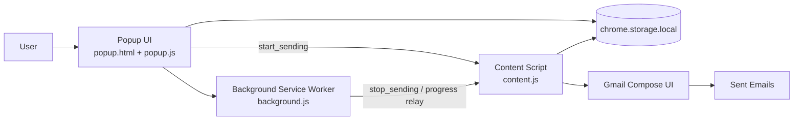
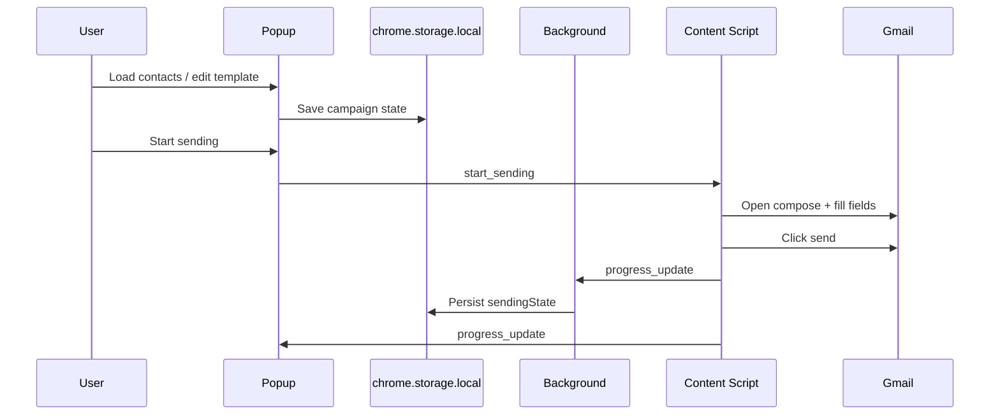

# Placement Email Bot - Chrome Extension Report

## Overview
This project is a Manifest V3 Chrome extension that automates placement outreach directly inside Gmail. The extension is split into a popup UI, a background service worker, and a Gmail content script that cooperates through `chrome.runtime` messaging and `chrome.storage.local` state.

## Architecture

## Main Components
- `manifest.json` declares the extension, permissions, Gmail host access, popup, and background worker.
- `popup.html`, `popup.js`, and `popup.css` provide the operator dashboard for contacts, templates, delay, CC/BCC, and send controls.
- `background.js` seeds default storage, relays progress, and forwards stop commands to open Gmail tabs.
- `content.js` performs the Gmail-side automation by opening compose windows, filling fields, and clicking Send.

## Workflow
1. The user opens the popup and loads a contact list.
2. The popup parses and stores contacts, templates, and sending settings in `chrome.storage.local`.
3. The popup checks whether the active tab is Gmail before enabling send actions.
4. When sending starts, the popup sends a `start_sending` message to the content script.
5. The content script opens Gmail compose windows, injects personalized subject/body text, and sends each email.
6. Progress and logs are written back to storage so the popup can recover state if it is closed and reopened.
7. If the user stops the campaign, the background script relays `stop_sending` to Gmail tabs.

## How The System Works At Runtime
- The popup is the control surface; it does not send emails directly.
- The background worker acts as a relay and persistence layer for progress and stop events.
- The content script is the execution engine and depends on Gmail DOM selectors.
- Sending is sequential and rate-limited using the configured delay and send limit.
- Contact placeholders such as `{name}`, `{company}`, and `{position}` are replaced per recipient.

## Data Flow

## Operational Notes
- The approach is tightly coupled to Gmail selectors, so UI changes in Gmail can require selector updates.
- State survives popup close/reopen because progress is mirrored into storage.
- The extension does not use a server; all orchestration happens in the browser.

## Summary
This extension is best viewed as a browser-native campaign runner: the popup prepares data, the background worker preserves state, and the content script performs the actual Gmail automation.